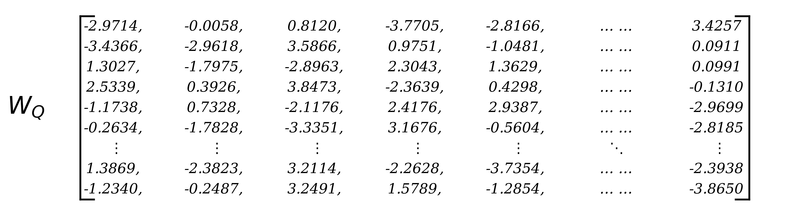
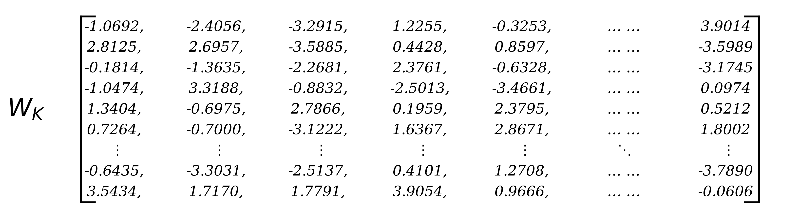
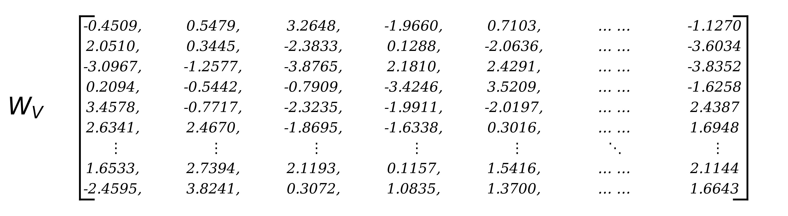
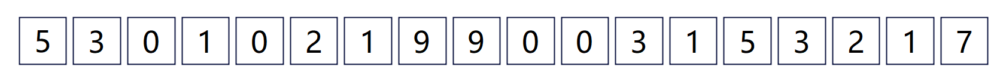
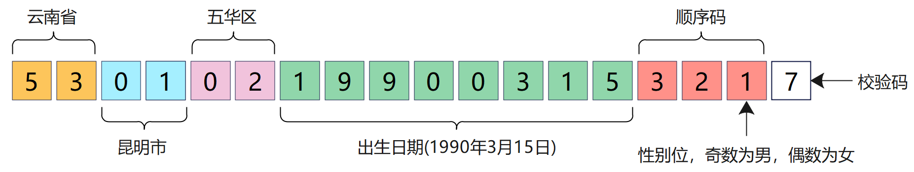
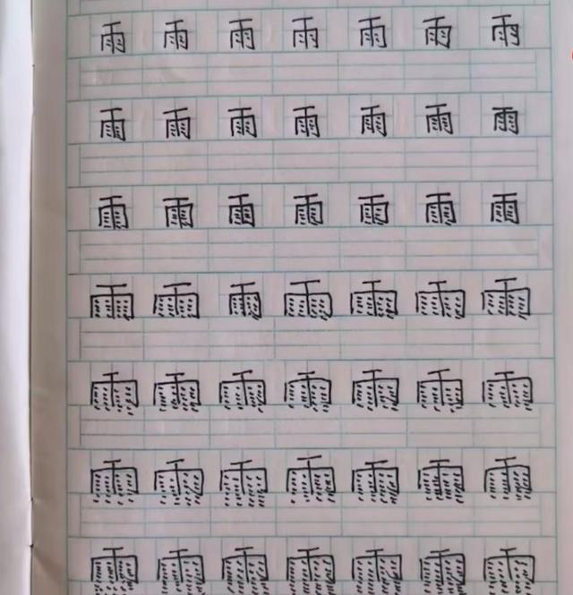
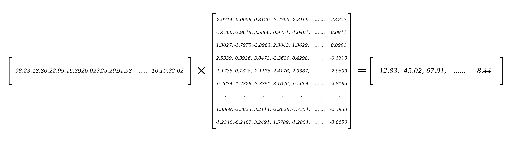
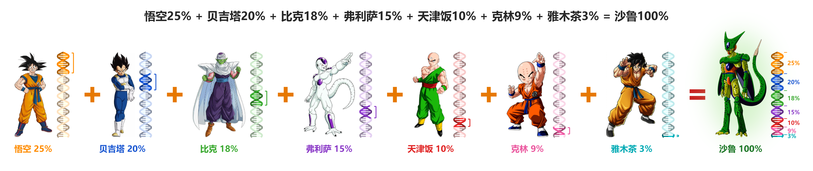
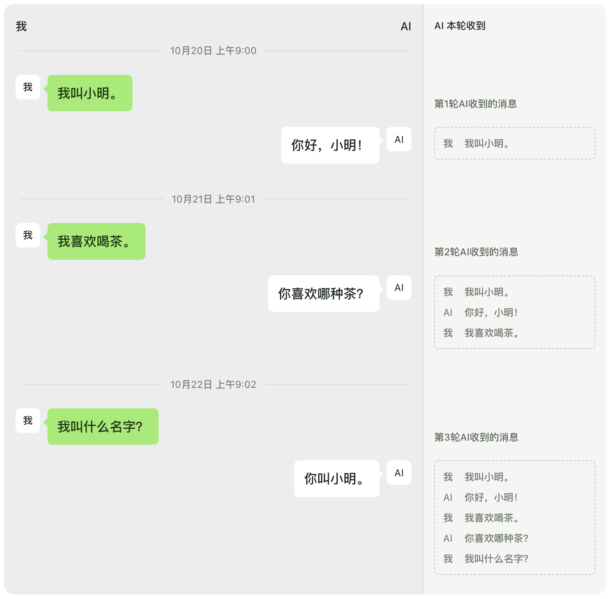

# 写给财务看的小册子——LLM

> 系列第 1 册 · 读者：非技术同事 · 约 20 分钟
> [系列目录](../README.md) · 下一册：Harness（写作中）

为通俗的介绍大语言模型（LLM），**该手册假设：每一个汉字，都是一个 Token。**

后文当我们说“某个汉字具备什么样的信息”的时候，就省去了和 Token——大模型实际的处理单位——之间的转换，减少财务阅读压力。

> 1 小时，重多少克？
>
> 1 立方米的空间，有什么味道？
>
> **1 个字，包含多少信息？**

前面两个问题，在逻辑上没有可回答的余地。最后一个问题，虽然也可能会让你产生一些诧异，但确有非常严格的物理定义，且能够被计算。

你可能要问，这和大模型有什么关系？实际上不仅有，而且还很大。大模型，本质上只是个**会吐字给你的机器**（请重复 3 遍），除了这个本领，其他什么都做不了。你看到的创建文档、回复消息、操作浏览器等等种种，都由智能体中的 Harness 体系完成，严格来说**和大模型没有任何关系**。Harness 也是一个特别有意思的体系，我们放到另一个小册子中讨论，这里只看大模型。

## 直观看一眼大模型

很遗憾，大模型不是一个可以直接双击运行的 exe 程序，所以我不能直接给你演示“下一步 → 下一步”的过程；也不是一个可以查询的数据库，所以我也不能给你呈现一些查询语句和效果；实际上，大模型是一个非常“数学范儿”的工具，它长得更像下面图示的样子：

  

**没错，就是这么丑 (mí) 陋 (rén)，非常不性感**

向量空间、矩阵变换充斥整个大模型，着实让不少初学者头疼。我向你保证，上面的三个矩阵，就是整本册子“唯三”的正式矩阵，后面不会出现了，我也不会用矩阵来解读大模型的工作原理。这里放几张图纯粹是“看一眼”，有个直观的感受而已。

**正如你已经知道的**：模型运行在计算机上，计算机在处理的，始终都是“数字”。

那么，如何用数字来表示现实世界中的内容，就成了第一个要解决的问题。

比如我想表示一个人，可使用他的身份证号 `[530102199003153217]`，这是我编造的，如有雷同，纯属雷同。

可能有些人知道，每个人的身份证编号，有很多信息在里面的。比如

也就是说，我可以用下面一串数字代表一个人：

`[53, 01, 02, 19900315, 321, 7]`

可是从上面这串数字中，我读不出这个人的**身高体重**怎么办？加……

`[53, 01, 02, 19900315, 321, 7, 175, 65]`

可是从上面这串数字中，我读不出这个人的**学历**怎么办？加……

`[53, 01, 02, 19900315, 321, 7, 175, 65, 02]`

可是从上面这串数字中，我读不出这个人的**爱好**怎么办？加……

`[53, 01, 02, 19900315, 321, 7, 175, 65, 02, 18, 23, 39]`

于是在一阵加加加之后，我们得到一个看起来没有规律，却**包含很多信息**的数字。

`[53,01,02,19900315,321,7,175,65,02,18,23,39,......-32.2319,67.2403,27.2934]`

如果上面的数字代表一个人，那么类比下面的数字，**则可以代表一个字**，比如**「林」**字。

`[-19.23,28.802,23.928,16.239,26.023,-25.293,91.93,......-10.139,32.0293]`

大模型，就是通过对这些数字的处理，来完成“吐字”的任务。

## 注意力机制——模型看到什么

要把字吐正确，其实不容易，模型得先知道你写的一句话中，包含哪些信息。

哪怕是一篇 2 万字的论文，大模型在处理的时候，也是一个字一个字的**逐字处理**，更神奇的是：

模型在处理最后一个字的时候，这个字里就包含了 2 万个字的信息。

> [!IMPORTANT]
> **“1 个字，包含 2 万个字的信息？？？”**

任何一个“字”，都有自己的含义。同时更重要的：也能包括**其他字**的信息。

> [!TIP]
> **“一个字里，可以包括其他字的信息”。**

- “晴”这个字，包含了太阳、温度、读音 (qing) 等信息；
- “魉”这个字，你哪怕第一时间读不出来，也能猜到八成不是什么好字，毕竟和鬼有关系；

而我们传统文化中的“合字”玩法，更是这种思路的很好的体现：

| **家和万事兴** | **日进斗金** | **马上有对象** |
|:---:|:---:|:---:|
|  |  |  |

也就是说，你写给大模型的如果是“马上有对象”五个字，当大模型处理完“象”最后一个字，他看到的可能真是：

反正这个奇怪的字，在大模型的眼里就类似下面这个样子：

`[98.23,18.80,22.99,16.39,26.023,-25.29,91.93,......-10.19,32.02]`

跟其他我们认为正常的字，没什么本质区别——都是一长串数字而已。

写到这里，我想起前几年，成都的一个小朋友写作业写上过热搜。那几天雨很大，小朋友写着写着，想要表达雨越下越大，于是就写成了下面的样子。

|  |  |
|:---:|:---:|

类似的，大模型每向后**处理一个字，都会造一个新字，来包含前面所有字的信息。**所以回到那篇 2 万字的论文：当处理完最后一个字的时候，这个新字里已经包含了**前面所有字的关键信息**。这种恐怖的造字能力，可能只有仓颉可以做到。

大模型如何做到的？就靠开篇我们看到的那三个不太性感的矩阵。

  

我们假设某个字的身份证信息如下：

`[98.23,18.80,22.99,16.39,26.023,-25.29,91.93,......-10.19,32.02]`

每一个字的身份证，都需要和上面那三个不那么好看的矩阵做乘法，得到一些信息。

同一个字的身份证，为什么要和三个不同的向量作这种运算？因为造一个新字你要知道三个信息：

1. 我要去看**哪些已有的字**。
2. 我要重点参考**这些字中的哪几个字**。
3. 我要参考**这几个字的什么信息**。

这三个问题中，加粗部分的内容，层层递进：

> <i>前面一共有 100 个字，这些字里 20 个是重点参考对象，这 20 个字的含义是……<b>开造！</b></i>

我不想用 `Q/K/V` 这种非常矩阵化的公式内容来展开描述，因为据说“书里每多一个公式，读者就会减少一半”。这话放到小册子上，可能也成立。

**不过我想请你建立的一个直觉是：**

造第 2 个字的时候，会用到第 1 个字和矩阵的计算结果；

造第 3 个字的时候，会用到第 1 个字和第 2 个字分别和矩阵的计算结果；

造第 4 个字的时候，会用到第 1 个字和第 2 个字和第 3 个字分别和矩阵的计算结果；

……

以此类推，这是个**自回归**的过程。

那么根据这个直觉，我请问：

> *假设我们现在正在创造第 10 个字。*
>
> *前面 9 个字的计算结果，在创造第 9 个字时已经计算过一遍了。*
>
> **第 10 个字的时候再算一遍是不是浪费？**

**答案：绝对是，而且非常浪费**

基于此，大模型往往都支持缓存机制，避免重复计算，就是你可能听过的 K/V 缓存。

有了 K/V 缓存，大模型在运行的时候，才可以“**又快又省钱**”。理解了这个过程，你就知道我们在介绍 Prompt 工程的时候，为什么有些指令（尤其是万年不变的指令）要放到前面，而另外一些要放到后面。

| 指令 1 | 指令 2 |
|---|---|
| 1. 回答和代码注释使用中文 | 1. `// 加入今天的日期` |
| 2. 改代码前先读 README.md 和现有目录结构，不要盲目新建文件 | 2. 回答和代码注释使用中文 |
| 3. 每次修改后运行测试，失败了先修复再继续 | 3. 改代码前先读 README.md 和现有目录结构，不要盲目新建文件 |
| 4. 不确定的 API 用法先问我，不要猜 | 4. 每次修改后运行测试，失败了先修复再继续 |
| 5. `// 加入今天的日期` | 5. 不确定的 API 用法先问我，不要猜 |

如果你每天都使用某个智能体，上面两份指令其实都不好，因为都存在容易变化的内容（每天的日期在变）。

- 指令 2 每天都会让你的缓存全部失效一次，因为第一条指令就产生了差异，后面造字的过程都需要重新算；
- 指令 1 每天也会让缓存失效一次，但至少前面 4 条指令的缓存是有效的，第 5 条后面造字的过程才需要重新算；

**所以指令 1 的编排方式更省钱。**

希望上面关于造字的描写，让你知道了大模型内部工作原理的一些内容。

其实如果你看过《龙珠》动漫，我更想使用沙鲁的诞生来表达“创造”的过程。

因为这个过程，可以把“归一化”——**DNA 总长度是不变的**——很形象的表达出来。

## 前馈神经网——模型想到什么

回到造字的例子上，现在我们假设模型已经造出了一个新字，可是这个字有什么意义？

前馈神经网（FFN）就在回答这个问题，可是这个玩意儿是用一种**什么方法**来回答的呢？

**“文字具备什么意义”，这其实是个极深的语言哲学问题。**

**荀子**《正名》中主张

> *名无固宜，约之以命，约定俗成谓之宜，异于约则谓之不宜。*
>
> *名无固实，约之以命实，约定俗成，谓之实名。*

荀子的观点不复杂，一个事物该叫什么名称，并没有天生合适的叫法，大家约定好，该咋叫就咋叫。

**罗素**是一位英国哲学家，也是一位逻辑大家（没错就是提出“罗素悖论”的罗素）。逻辑学家看待日常语言的时候，就没有那种“咋叫都行”的释然，更多反而带有一种警惕。罗素认为，自然语言是病人，逻辑是手术刀。

在众多语言哲学家的观点中，我特别推崇**维特根斯坦**，一位奥地利大哥，高富帅。

他主张：**语言的意义是「被使用」**。

这话一点都不抽象，看几个例子你就明白。

1. “给力”这个词，1987 年以前应该没人知道是什么意思，现在你知道了；
2. “绿茶”这个词，本来就是一种茶叶，不过在现在大模型的知识关系中，这个词十之八九和“有心机”、“暧昧”、“清纯柔弱”等词有关系；
3. “我勒个豆”这个词，本来我也不懂，听小孩子们经常这么讲之后发现，原来也是表示吃惊的意思；

说了这些，总算可以回答前馈神经网是如何思考的了。总结下来就是：

**看看这个新造的字，以前被人类如何使用过。**

> <i><b>“看看”</b>的过程，还是矩阵乘法。为了不让读者数量再减半，不写出来了。</i>

这个“字”，具备什么样的意义，完全看**人类以前的知识结构**中，如何使用过。

而人类以前的“知识结构”，则来自于大模型的**训练语料**。

- 如果你用优秀的代码库来训练模型，它会吐出优秀的代码；
- 如果你用优秀的哲学论文来训练模型，它不会给你吐代码，但是会给你吐出哲学观点；

感谢互联网，让我们几乎可以获得所有想获得的知识。但有一个事实：**优秀的训练用语料，依然很贵**

> [!NOTE]
> 这也是为什么鲜有商业化公司，开放自己模型的训练语料的原因之一：**语料也是竞争力的一部分**。
>
> 前向，不开源自己的训练语料、训练配方；
> 后向，不开源自己的推理引擎、部署链路；
> 只把中间模型的权重开源出来，问题不算太大。

因为要存储海量的字和字之间的**关系**，所以前馈神经网是极其巨大的。实际上，一个万亿参数的模型，可能有 7000 亿（超过一半）的参数会在前馈神经网里面。

所以，同样的注意力机制，同样的新字（比如下面这个数字串），经过不同的前馈神经处理之后，可能会产生完全不同的意义——模型想到的内容差异是巨大的。

`[-19.23,28.802,23.928,16.239,26.023,-25.293,91.93,......-10.139,32.0293]`

这个过程有一点点像，大人的脑袋和小孩子的脑袋。

请把这两个脑袋想象成两个 FFN，**同样看到**一只红色的螃蟹……

> 大人：螃蟹熟了，准备蟹醋、芥末
>
> 孩子：螃蟹很害羞，脸都红了

同样的输入，不一样的反应。其实就是大人和孩子“被训练”的经历不同，产生的前馈神经网不同而已。

## 伪记忆——模型从来不认识你

上面的内容，基本包括了 Transformer 架构下大模型里最重要的两个模块（Attention & FFN）的工作机制的描述。把模型如何看，如何想的过程进行了拆解。

  

如你已经看到的：模型本身没有任何地方记住你是谁，你的喜好如何。

大模型没有状态，没有记忆，只有一次次**独立的**“你问，我答”。表现出来就是你问个问题，它根据这个问题不断的吐字吐字吐字，直到结束。

其实你和模型之间的对话交互，有点类似于迭代的对话：

如上图示，我构造了三轮跨天的对话。

左侧是我和 AI 的**“持续的对话”**，右侧是模型每次收到的**“独立的对话”**。在第三轮我问 AI“我叫什么名字”的时候，它之所以表现的好像记住了前天的内容，是因为在第三轮给大模型的输入中，**已经包含了历史对话**。

你可以想象一下：如果我一直和 AI 聊下去，等到第 N 轮的时候，右侧累加的历史内容会越来越多。

实际情况也确实如此，这就是模型公司经常说的“**上下文窗口**”的价值。

从 128K token 的窗口（放 7～8 万字不成问题），到 1M token 的窗口（约 50～60 万字），不同的模型有不同的选择。

## 附录/纠偏

1. 我一直说“某个字”的数字化表示，其实是不对的。模型工作的时候，处理单元是 Token（词元），一个 Token 可能是一个字，两个字或者其他。Token 先经过向量化之后，变成一串数字，才能被模型处理
2. 我隐喻了 Token 的向量表示，是有含义的（像身份证号码一样），比如第一个数字代表什么，第二个数字代表什么，但其实这些数字都是训练出来的，没有人类视角上的任何“含义”
3. 在我的描述中，一个 Token 自己就能被向量化成一串数字，其实跟着 Token 一起向量化的，还有该 Token 所在的“位置”信息。同样的字，位置不同，向量化之后的结果也有差异

---

*本册为「写给财务看的小册子」系列第 1 册 · [返回目录](../README.md)*

*发现错误欢迎提 Issue 勘误 · 转载请遵循 [CC BY-NC-SA 4.0](../LICENSE.md)*
